<div align="center">


<br>

       

**[⚙️ Pipeline](#pipeline)** · **[📊 Results](#results)** · **[🚀 Run it](#run)** · **[⚠️ Limits](#limits)**

<br>

<b>Hold up a photo, and most face-attendance systems mark you present.</b><br>
SecureFace puts a <b>liveness model I trained myself</b> in front of recognition, so only a real, live person can check in.

</div>

<br>

<a id="results"></a>



<a id="pipeline"></a>

<br>



<details>
<summary><b>The pipeline, step by step</b></summary>
<br>

1. **Detect:** BlazeFace must find exactly one face.
2. **Track:** if the face box jumps (IoU below 0.25 with the previous frame), it is treated as a new person and the check restarts.
3. **Crop:** face plus a 25% margin at 224×224 with ImageNet normalisation, byte-identical to training (guarded by a test).
4. **Liveness:** MobileNetV3-Small gives P(spoof), averaged over the last 5 frames, then a calibrated three-way decision:
   **LIVE**, **SPOOF** or **UNCERTAIN**. Only LIVE continues.
5. **Recognise:** Face Mesh alignment and an ArcFace (`w600k_r50`) 512-D embedding, matched by cosine similarity.
6. **Random challenge (second check):** the scanner shows one random instruction, "Turn your head left" or
   "Turn your head right", then asks for one natural blink. The server checks both from its own Face Mesh
   readings (head yaw, then eyes open → closed → open), for the same face, within 15 s. A wrong-way turn or a
   timeout starts a new random challenge. Nothing the browser sends is trusted.
7. **Attendance:** Present or Late (admin cut-off), once per day. Every stage is logged with its scores.

| Model | Trained here? | Job |
|---|:---:|---|
| **MobileNetV3-Small liveness classifier** | ✅ [`training/`](training/) | Real face or spoof |
| BlazeFace short-range (MediaPipe) | — | Face detection |
| MediaPipe Face Landmarker, 478 points | — | Alignment, head turn and eye openness for the challenge |
| ArcFace `w600k_r50` (InsightFace, ONNX) | — | 512-D identity embedding |
</details>

<br>



<br>



<br>



<br>



<br>



<sub>All numbers come from <a href="training/results/summary.json"><code>training/results/summary.json</code></a> (held-out CelebA-Spoof test set, 1,950 live + 1,950 spoof) and <a href="docs/pipeline_latency_2026-11-07.txt"><code>docs/pipeline_latency_2026-11-07.txt</code></a>. APCER = attacks wrongly accepted · BPCER = real faces wrongly rejected · HTER = their average.</sub>

<a id="run"></a>

## 🚀 Run it on your laptop

**Windows:** install 64-bit Python 3.13, download or clone this repository, run **`setup.cmd`** once (it creates a
private virtual environment and asks you to create your admin account), then **`start.cmd`**, and open
<http://localhost:5000>.

**macOS / Linux:**

```bash
python3.13 -m venv venv
./venv/bin/pip install -r requirements.txt
cp .env.example .env                       # set SECRET_KEY and FACE_ENCRYPTION_KEY
./venv/bin/python scripts/create_admin.py  # no credentials are hard-coded
./venv/bin/python run_local.py             # http://localhost:5000
```

The first start downloads the pretrained vision models. Then:

1. 🧑‍🎓 Students create accounts and choose **Register face** on their dashboard (5 samples, one face in view).
2. 📷 Open the scanner (`/`) on the attendance laptop, look at the camera, turn your head the way it asks, then blink once.
3. 🔐 Optional: Settings → Scanner → **Require approved scanner device**, then **Set this device as scanner** on each kiosk.

<details>
<summary><b>🌐 Reach the app from other devices (Cloudflare Tunnel)</b></summary>
<br>

After the local app works, install `cloudflared` from the
[Cloudflare guide](https://developers.cloudflare.com/cloudflare-one/connections/connect-networks/downloads/) and run
`cloudflared tunnel --url http://127.0.0.1:5000` in a second terminal. Open the printed HTTPS address on the scanner,
sign in as admin, approve the browser and log out. A new temporary hostname needs a new approval. Ctrl+C in the
tunnel terminal stops public access.
</details>

<details>
<summary><b>🧪 Tests and scripts</b></summary>
<br>

```bash
./venv/bin/pytest -v
```

The tests cover the crop-identity regression, login and roles, students blocked from admin pages, CSRF, scanner
device approval, attendance marking and "Already marked today", the server-side head-turn + blink challenge, the wipe confirmation,
registration owner checks and Test Mode never marking attendance. Each test uses a temporary database.

```bash
./venv/bin/python scripts/create_test_student.py            # student login (face registered later)
./venv/bin/python scripts/reset_password.py you@example.com  # local password reset
./venv/bin/python scripts/measure_pipeline_latency.py      # real latency against a running server
./venv/bin/python generate_report.py                         # rebuild SecureFace_Attendance_Report.pdf
```
</details>

<details>
<summary><b>🗂️ Project structure</b></summary>
<br>

```
app.py              routes and the scan pipeline (api_recognize_face)
liveness/           liveness inference: detector + crop, model, predictor, weights
utils/face_utils.py Face Mesh + ArcFace recognition, encrypted embeddings
utils/gradcam.py    Grad-CAM for Pipeline View
database/           SQLite / Postgres layer and schema
templates/, static/ the web interface
training/           model training and evaluation code, with the real result files
scripts/, tests/, docs/
```

Each installation creates its own empty SQLite database in `database/smartface.db`. Back up the database together
with the private `.face_key`; keep the database, keys, uploads and the virtual environment out of Git.
</details>

<a id="limits"></a>

## ⚠️ Known limits

> [!NOTE]
> The numbers above are **dataset** numbers. A real webcam is a different domain: live faces often land in the
> UNCERTAIN band, and a phone photo was once judged LIVE. A data-collection tool is built in (Test Mode → Collection
> mode) and the plan is in [`docs/domain_adaptation_plan.md`](docs/domain_adaptation_plan.md).

- **Two checks against spoofing.** The liveness model is the first check. On this project's webcam it was fooled by
  phone photos (Test Mode, 2026-11-24), so the random head-turn + blink challenge is the second check: a flat photo
  can't turn its head (tilting a photo moves the measured yaw by at most 0.025, the turn needs 0.12) and can't
  blink, and a replayed video only passes if it happens to turn the randomly asked way and then blink in time.
  A live person puppeting a high-quality 3D mask, or a real-time deepfake that follows instructions, is not covered.
- This local edition uses SQLite on the host laptop.

📄 Full engineering notes: [`docs/HANDOVER.md`](docs/HANDOVER.md) · Report: [`SecureFace_Attendance_Report.pdf`](SecureFace_Attendance_Report.pdf)

## 🙏 Credits

- The web app started from the open-source Flask app
  [Smart-Attendance-System](https://github.com/Sofzenix/Smart-Attendance-System) (MIT, see [LICENSE](LICENSE)); the
  liveness model, its training and evaluation, and the scan pipeline were built for this project. The original
  liveness training project is archived on the
  [`archive/liveness-v1`](https://github.com/Yuvika687/secureface-attendance/tree/archive/liveness-v1) branch.
- Dataset: [CelebA-Spoof](https://github.com/ZhangYuanhan-AI/CelebA-Spoof). Pretrained models: Google MediaPipe
  (BlazeFace, Face Landmarker) and InsightFace (ArcFace `w600k_r50`).
