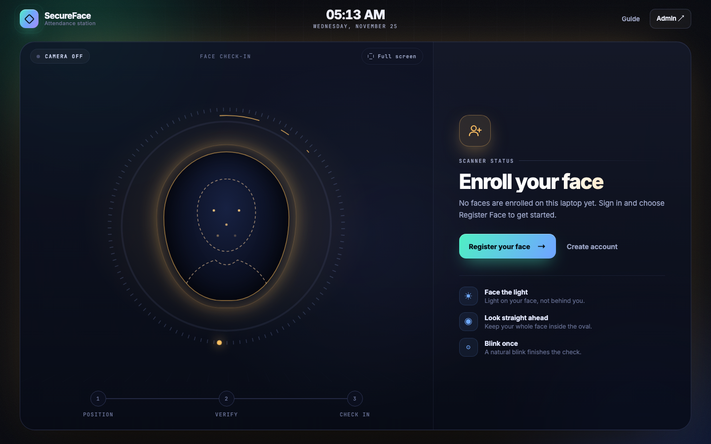
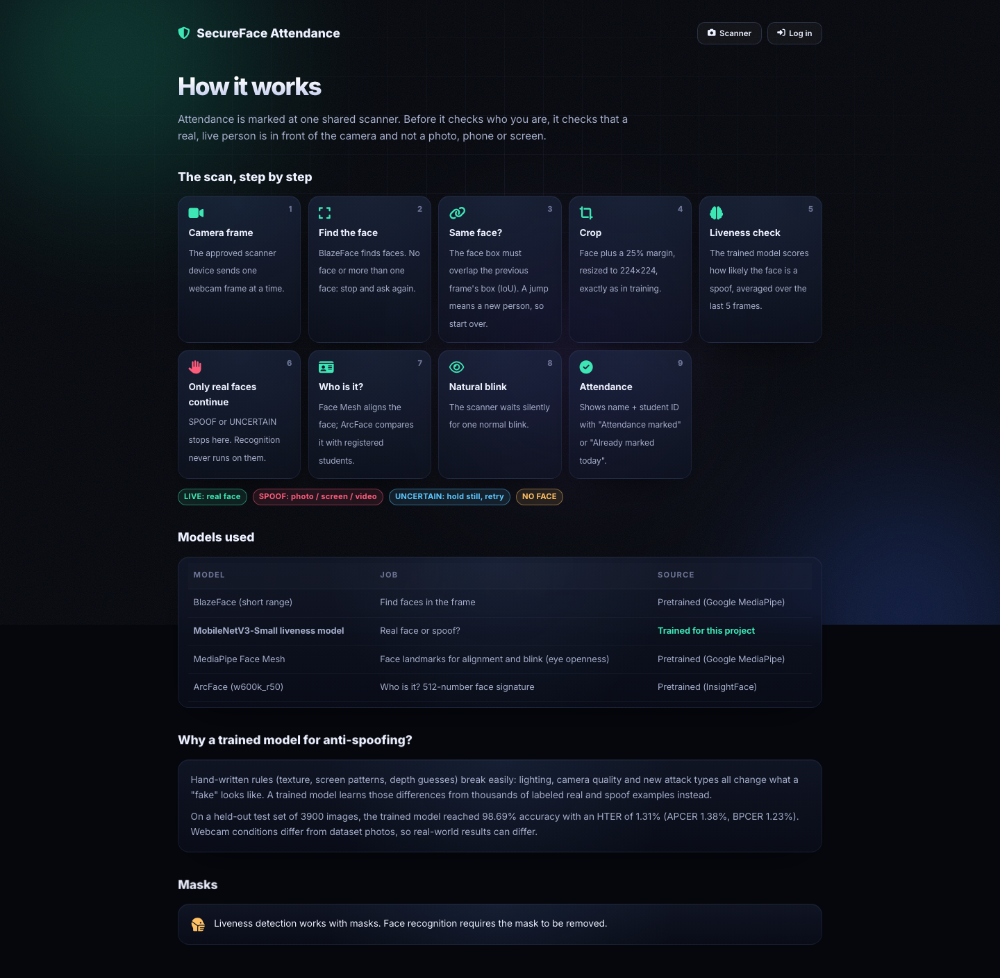
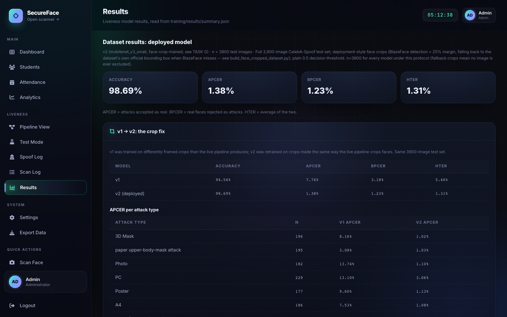
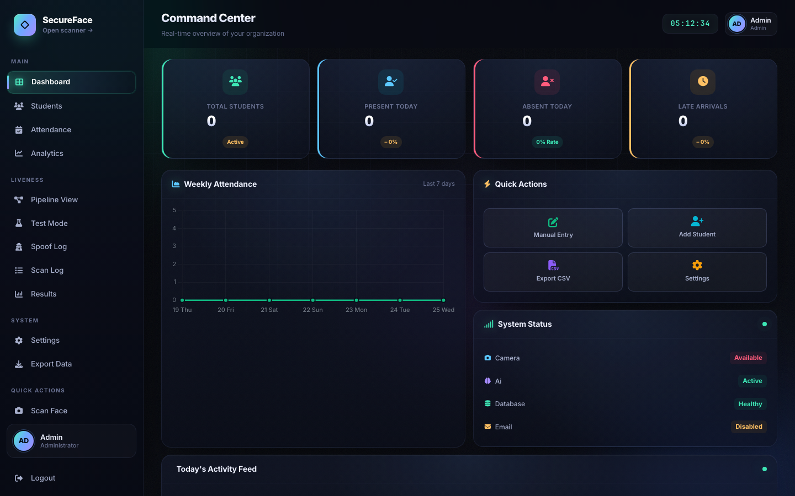
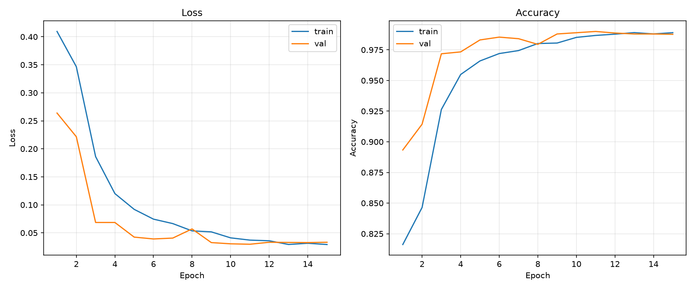
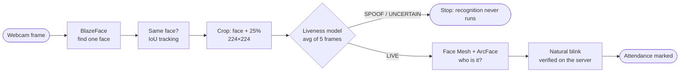
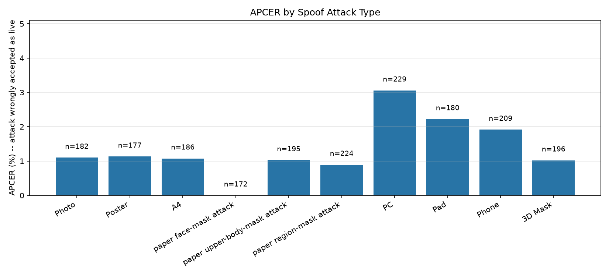

<div align="center">



<br>

       

**[Screenshots](#screenshots)** · **[How a scan works](#how-a-scan-works)** · **[Results](#results)** · **[Run it](#run-it-on-your-laptop)** · **[Limits](#known-limits)**

</div>

<br>

Face-recognition attendance is easy to fool: hold up a photo or a phone and the camera sees a face.
**SecureFace** puts a **liveness (anti-spoofing) model that I trained myself** in front of recognition, so only a real,
live person can mark attendance. Printed photos, screen replays and 3D masks are screened out before recognition ever
runs: on the held-out test set the model catches **98.6% of attacks** while wrongly rejecting only **1.2% of real faces**.

<p align="center">
  
  <br>
  <sub>The shared scanner: step into the oval, the liveness model checks the face is real, a natural blink finishes the check-in.</sub>
</p>

## Highlights

<table>
<tr>
<td width="50%" valign="top">

### 🧠 Self-trained liveness model
MobileNetV3-Small trained on **CelebA-Spoof**: **98.69% accuracy** and **1.31% HTER** on a held-out
3,900-image test set, benchmarked against ResNet18 and EfficientNet-B0.

</td>
<td width="50%" valign="top">

### 🔍 Found and fixed a real bug with error analysis
v1 was trained on face crops framed differently from the live pipeline. Retraining on crops made exactly like
the live ones raised accuracy from **94.54% to 98.69%**, and a test now guards that the crops stay identical.

</td>
</tr>
<tr>
<td width="50%" valign="top">

### ⚡ Fast, full pipeline
BlazeFace detection → liveness → ArcFace matching → server-verified blink, with a **80.6 ms median round trip**
measured over 45 real requests to the running app.

</td>
<td width="50%" valign="top">

### 🛡️ Built like a real product
Student and admin roles, CSRF protection, Fernet-encrypted face embeddings, approved scanner devices, audit
logs, Grad-CAM explanations and a Test Mode that measures APCER/BPCER live.

</td>
</tr>
</table>

## Screenshots

<table>
<tr>
<td width="50%" valign="top">

<p align="center"><b>How it works</b>: the public page that explains every step</p>
</td>
<td width="50%" valign="top">

<p align="center"><b>Results</b>: model metrics read live from <code>training/results/summary.json</code></p>
</td>
</tr>
<tr>
<td width="50%" valign="top">

<p align="center"><b>Admin dashboard</b>: attendance at a glance (fresh, empty install)</p>
</td>
<td width="50%" valign="top">

<p align="center"><b>Training</b>: loss and accuracy over 15 epochs (v2 model)</p>
</td>
</tr>
</table>

## How a scan works



1. **Detect:** BlazeFace must find exactly one face.
2. **Track:** if the face box jumps (IoU below 0.25 with the previous frame), it is treated as a new person and the check restarts.
3. **Crop:** face plus a 25% margin at 224×224 with ImageNet normalisation, byte-identical to training.
4. **Liveness:** MobileNetV3-Small gives P(spoof), averaged over the last 5 frames, then a calibrated three-way decision:
   **LIVE**, **SPOOF** or **UNCERTAIN**. Only LIVE continues.
5. **Recognise:** Face Mesh alignment and an ArcFace (`w600k_r50`) 512-D embedding, matched by cosine similarity.
6. **Blink:** a silent, natural blink (open → closed → open, same person, within 8 s), checked on the server; the
   browser's own flag is ignored.
7. **Attendance:** Present or Late (admin cut-off), once per day. Every stage is logged with its scores.

| Model | Trained here? | Job |
|---|:---:|---|
| **MobileNetV3-Small liveness classifier** | ✅ ([`training/`](training/)) | Real face or spoof |
| BlazeFace short-range (MediaPipe) | — | Face detection |
| MediaPipe Face Landmarker, 478 points | — | Alignment and eye openness for the blink |
| ArcFace `w600k_r50` (InsightFace, ONNX) | — | 512-D identity embedding |

## Results

All numbers come from the held-out **3,900-image CelebA-Spoof test set** (1,950 live, 1,950 spoof) and are stored in
[`training/results/summary.json`](training/results/summary.json).

| Deployed model | Accuracy | APCER | BPCER | HTER |
|---|:---:|:---:|:---:|:---:|
| **MobileNetV3-Small (v2)** | **98.69%** | 1.38% | 1.23% | **1.31%** |

<sub>APCER = attacks wrongly accepted as real · BPCER = real faces wrongly rejected · HTER = the average of the two.</sub>

**The v1 → v2 crop fix.** Error analysis showed v1 was trained on differently framed crops than the live pipeline
produces. Retraining on matching crops:

| | Accuracy | APCER | BPCER | HTER |
|---|:---:|:---:|:---:|:---:|
| v1 | 94.54% | 7.74% | 3.18% | 5.46% |
| **v2 (deployed)** | **98.69%** | **1.38%** | **1.23%** | **1.31%** |

**Backbone comparison** (same test set and protocol):

| Backbone | Accuracy | HTER | Parameters | File size | ONNX CPU latency |
|---|:---:|:---:|:---:|:---:|:---:|
| **MobileNetV3-Small (deployed)** | 98.69% | 1.31% | **1.0 M** | **4.0 MB** | **2.8 ms** |
| ResNet18 | 98.90% | 1.10% | 11.2 M | 43.0 MB | 17.3 ms |
| EfficientNet-B0 | 99.26% | 0.74% | 4.2 M | 16.2 MB | 7.7 ms |

The larger backbones are slightly more accurate. MobileNetV3-Small was kept because it is 11× smaller than ResNet18
and the fastest on ONNX CPU, for a model that runs on every webcam frame.

<p align="center">
  
  <br>
  <sub>Error by attack type: every attack type stays at or below about 3% APCER (PC screens are the hardest).</sub>
</p>

**Measured pipeline latency** (45 real requests to the running app,
[`docs/pipeline_latency_2026-11-07.txt`](docs/pipeline_latency_2026-11-07.txt)): median round trip **80.6 ms**;
BlazeFace 3.9 ms, liveness 13.1 ms, recognition 58.0 ms (medians).

> These are dataset numbers. A real webcam is a different domain from dataset photos; see
> [Known limits](#known-limits) and [`docs/domain_adaptation_plan.md`](docs/domain_adaptation_plan.md).

## Features

| Part | Who | What |
|---|---|---|
| **Scanner** (`/`) | Anyone (optionally only approved devices) | Camera → liveness → recognition → blink → attendance, with name and student ID shown. |
| **Student pages** | Logged-in students | Create an account, register a face once (5 samples), view their own attendance. |
| **Admin pages** | Logged-in admins | Dashboard, Students (with **Reset face**), Attendance (summary, chart, filters, CSV), **Pipeline View** with Grad-CAM, **Test Mode**, Spoof Log and Scan Log, **Results**, Settings. |
| **How it works** (`/how_it_works`) | Everyone | A public page that explains the pipeline. |

**Security:** hashed passwords, CSRF tokens on every form, Fernet-encrypted face embeddings, per-session liveness
state, server-side blink verification, optional approved scanner devices (SHA-256 hashed device tokens) and an
admin audit log.

## Run it on your laptop

**Windows:** install 64-bit Python 3.13, download or clone this repository, run **`setup.cmd`** once (it creates a
private virtual environment and asks you to create your admin account), then **`start.cmd`**, and open
<http://localhost:5000>.

**macOS / Linux:**

```bash
python3.13 -m venv venv
./venv/bin/pip install -r requirements.txt
cp .env.example .env                       # set SECRET_KEY and FACE_ENCRYPTION_KEY
./venv/bin/python scripts/create_admin.py  # no credentials are hard-coded
./venv/bin/python run_local.py             # http://localhost:5000
```

The first start needs internet to download the pretrained vision models.

1. Students create accounts and choose **Register face** on their dashboard (5 samples, one face in view).
2. Open the scanner (`/`) on the attendance laptop, look at the camera and blink once.
3. Optional: to allow only specific laptops to scan, turn on Settings → Scanner → **Require approved scanner device**,
   then click **Set this device as scanner** on each one while logged in as admin.

<details>
<summary><b>Optional: reach the app from other devices (Cloudflare Tunnel)</b></summary>
<br>

After the local app works, install `cloudflared` from the
[Cloudflare guide](https://developers.cloudflare.com/cloudflare-one/connections/connect-networks/downloads/) and run
`cloudflared tunnel --url http://127.0.0.1:5000` in a second terminal. Open the printed HTTPS address on the scanner,
sign in as admin, approve the browser and log out. A new temporary hostname needs a new approval. Ctrl+C in the
tunnel terminal stops public access.
</details>

<details>
<summary><b>Tests and scripts</b></summary>
<br>

```bash
./venv/bin/pytest -v
```

The tests cover the crop-identity regression, login and roles, students blocked from admin pages, CSRF, scanner
device approval, attendance marking and "Already marked today", the server-side blink, the wipe confirmation,
registration owner checks and Test Mode never marking attendance. Each test uses a temporary database.

```bash
./venv/bin/python scripts/create_test_student.py            # student login (face registered later)
./venv/bin/python scripts/reset_password.py you@example.com  # local password reset
./venv/bin/python scripts/measure_pipeline_latency.py      # real latency against a running server
./venv/bin/python generate_report.py                         # rebuild SecureFace_Attendance_Report.pdf
```
</details>

<details>
<summary><b>Data and privacy</b></summary>
<br>

Each installation creates its own empty SQLite database in `database/smartface.db`. Back up the database together
with the private `.face_key` after stopping the app. Keep the database, keys, uploads and the virtual environment out
of Git.
</details>

## Project structure

```
app.py              routes and the scan pipeline (api_recognize_face)
liveness/           liveness inference: detector + crop, model, predictor, weights
utils/face_utils.py Face Mesh + ArcFace recognition, encrypted embeddings
utils/gradcam.py    Grad-CAM for Pipeline View
database/           SQLite / Postgres layer and schema
templates/, static/ the web interface
training/           model training and evaluation code, with the real result files
scripts/, tests/, docs/
```

## Known limits

- The model was trained on dataset photos. On a real webcam, live faces often land in the UNCERTAIN band, and a phone
  photo was once judged LIVE. A data-collection tool is built in (Test Mode → Collection mode) and the plan is in
  [`docs/domain_adaptation_plan.md`](docs/domain_adaptation_plan.md).
- The blink check does not stop a video replay (a video blinks too); the liveness model is the main defence.
- This local edition uses SQLite on the host laptop.

Full engineering notes: [`docs/HANDOVER.md`](docs/HANDOVER.md) · Report:
[`SecureFace_Attendance_Report.pdf`](SecureFace_Attendance_Report.pdf)

## Credits

- The web app started from the open-source Flask app
  [Smart-Attendance-System](https://github.com/Sofzenix/Smart-Attendance-System) (MIT, see [LICENSE](LICENSE)); the
  liveness model, its training and evaluation, and the scan pipeline were built for this project. The original
  liveness training project is archived on the
  [`archive/liveness-v1`](https://github.com/Yuvika687/secureface-attendance/tree/archive/liveness-v1) branch.
- Dataset: [CelebA-Spoof](https://github.com/ZhangYuanhan-AI/CelebA-Spoof). Pretrained models: Google MediaPipe
  (BlazeFace, Face Landmarker) and InsightFace (ArcFace `w600k_r50`).
